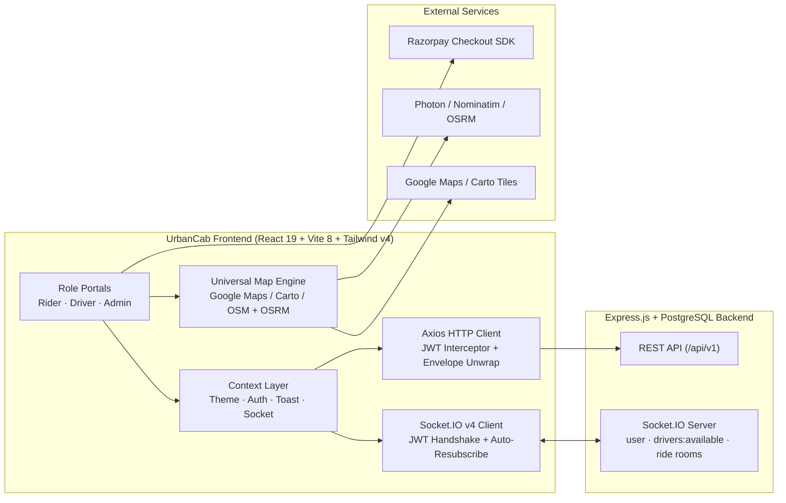
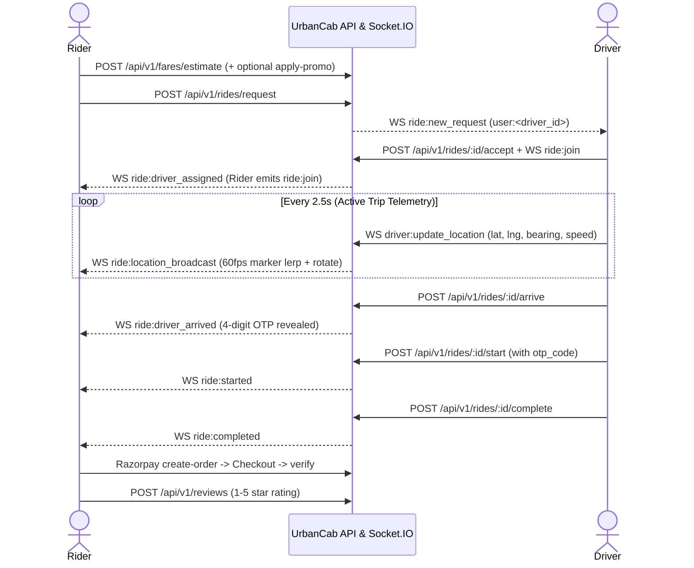

<a id="readme-top"></a>

<div align="center">

<h1>UrbanCab</h1>

<p><strong>Real-time on-demand urban mobility, multi-stop cab booking, live GPS telemetry, and fleet operations platform.</strong></p>

<p>
  
  
  
  
  <a href="https://cab-booking-frontend-jade.vercel.app/"></a>
</p>

<p>
  <a href="https://cab-booking-frontend-jade.vercel.app/"><strong>Live Demo</strong></a> ·
  <a href="#features">Features</a> ·
  <a href="#architecture">Architecture</a> ·
  <a href="#universal-map-engine">Map Engine</a> ·
  <a href="#quickstart">Quickstart</a> ·
  <a href="#routes--role-based-access">Routes &amp; RBAC</a> ·
  <a href="#real-time-websocket-protocol">WebSockets</a> ·
  <a href="#deployment">Deployment</a>
</p>

</div>

---

## Overview

**UrbanCab** (`cab-booking-frontend`) is a production-grade React 19 + Vite 8 web application engineered for real-time ride dispatching, road-snapped navigation, Razorpay payment settlement, emergency SOS monitoring, and multi-role fleet management.

The application delivers three dedicated, role-protected operational experiences—**Rider**, **Driver Partner**, and **Admin / Safety Dispatcher**—over a unified Axios REST client, a Light/Dark/System theme engine, and a JWT-authenticated Socket.IO v4 telemetry layer.

> [!NOTE]
> This repository contains the **frontend SPA** designed to connect with the UrbanCab Express.js + PostgreSQL + Socket.IO backend (`/api/v1`). Configure `VITE_API_URL` in `.env` to point at your local or deployed backend instance.

---

<a id="features"></a>
## Platform Capabilities

<table>
  <tr>
    <td width="33%" valign="top">
      <h3>Rider Experience</h3>
      <ul>
        <li><strong>Multi-Stop Booking:</strong> Autocomplete address search (Photon OSM + Nominatim) with reorderable intermediate stops and curated metro hub presets across 6 Indian cities.</li>
        <li><strong>Dynamic Fare &amp; Promos:</strong> Instant estimates across <code>standard</code>, <code>comfort</code>, and <code>premium</code> vehicle classes with async promo-code validation.</li>
        <li><strong>Live Tracking &amp; OTP:</strong> Radar search modal, live 60fps vehicle tracking with directional heading, 4-digit boarding OTP, and audio cues.</li>
        <li><strong>Payments &amp; Invoices:</strong> Integrated Razorpay Checkout, cryptographic verification, printable GST digital receipts, trip history, and 5-star reviews.</li>
        <li><strong>Safety &amp; Help Desk:</strong> One-tap 3-second countdown SOS distress trigger, trusted emergency contacts, and support ticket tracking.</li>
      </ul>
    </td>
    <td width="33%" valign="top">
      <h3>Driver Partner Console</h3>
      <ul>
        <li><strong>Onboarding &amp; Vehicle Profile:</strong> Self-service driver license and vehicle specification registration with live admin verification status.</li>
        <li><strong>Availability &amp; GPS Telemetry:</strong> Online/offline toggle streaming throttled 2.5s GPS coordinates, heading bearing, and speed via WebSockets.</li>
        <li><strong>Built-in Route Simulator:</strong> Desktop-friendly Bengaluru telemetry track simulator when hardware GPS is unavailable.</li>
        <li><strong>Incoming Dispatch Modal:</strong> Real-time trip request alerts with fare, distance, ETA, sound chime, and countdown timer.</li>
        <li><strong>Guided Trip Execution:</strong> Step-by-step workflow (<code>Accept</code> → <code>Arrive</code> → <code>Verify OTP &amp; Start</code> → <code>Complete</code>) plus an itemized earnings &amp; payout ledger.</li>
      </ul>
    </td>
    <td width="33%" valign="top">
      <h3>Admin &amp; Safety Operations</h3>
      <ul>
        <li><strong>Driver Verification &amp; Fleet Desk:</strong> Live KPI overview, tabbed queues (<code>Pending</code>, <code>Verified</code>, <code>Unverified</code>, <code>All</code>), debounced search, pagination, inspection drawer, and approve/revoke workflows.</li>
        <li><strong>Live Emergency SOS Monitor:</strong> Global <code>admin:emergency_alert</code> socket listener, distress coordinate map pinning, and incident resolution notes.</li>
        <li><strong>Support Dispute Queue:</strong> Categorized ticket triage (<code>lost_item</code>, <code>payment_issue</code>, <code>driver_behavior</code>, <code>safety</code>, <code>other</code>) with inline admin replies and status updates.</li>
        <li><strong>System Health Diagnostics:</strong> Real-time backend latency monitor, PostgreSQL connectivity status, server uptime, and WebSocket engine checks.</li>
      </ul>
    </td>
  </tr>
</table>

---

<a id="architecture"></a>
## Architecture

### System Topology



### End-to-End Ride Dispatch Lifecycle



---

<a id="universal-map-engine"></a>
## Universal Map & Routing Engine

`src/components/map/MapEngine.jsx` and `src/components/map/LiveRouteMap.jsx` implement a resilient **3-tier progressive map engine** that works out of the box with zero API keys while unlocking richer providers automatically when keys are configured:

| Tier | Provider | Activation | Routing & Visuals |
| :--- | :--- | :--- | :--- |
| **Level 1** | **Google Maps JS API** | `VITE_GOOGLE_MAPS_API_KEY` set | Native turn-by-turn Google Directions, custom obsidian styling, runtime toggle back to Leaflet |
| **Level 2** | **Leaflet + CartoDB** | `VITE_CARTO_API_KEY` set | High-contrast Carto Dark Matter (split base + illuminated labels pane) & Voyager Daylight toggle + OSRM road snapping |
| **Level 3** | **Leaflet + OpenStreetMap** | Zero-key default fallback | Watermark-free worldwide OSM tiles with Obsidian dark CSS filter + OSRM road snapping (with Bezier curve instant preview) |

### Navigation Highlights
- **Instant Perceived Zero-Latency Routing:** Immediately draws a curved Bezier path (`generateCurvedRoute`) while asynchronously snapping the polyline to real streets via OSRM (`fetchStreetRoute`) with an in-memory route cache.
- **60fps Vehicle Telemetry Layer:** Driver location updates run in a dedicated Leaflet layer (`driverLayerRef`) isolated from route recalculations, smoothly updating coordinates and rotating a top-down aerodynamic SVG vehicle icon along the live heading `bearing`.
- **Smart Address & Hub Search (`places.service.js`):** Queries **Photon (Komoot)** first, falls back to **OpenStreetMap Nominatim**, and includes curated major hub presets across **Mumbai, Pune, Bengaluru, Delhi NCR, Hyderabad, and Chennai** plus coordinate reverse geocoding.
- **Floating HUD Overlay (`LiveRouteMap.jsx`):** Live distance (`km`), ETA (`mins`), stop counter, driver speed (`km/h`), compass heading (`°`), and one-click expand-to-`85vh` viewport mode.

---

<a id="quickstart"></a>
## Quickstart

### Prerequisites

- **Node.js** `>= 20.x` and **npm** `>= 10.x`
- A running **UrbanCab Backend** server (defaults to `http://localhost:5213`)

### 1. Clone & Install

```bash
git clone https://github.com/Bluewick/cab-booking-frontend.git
cd cab-booking-frontend
npm install
```

### 2. Configure Environment Variables

Create a `.env` file in the project root:

```bash
# Backend API & Socket.IO origin (required for non-default backend ports)
VITE_API_URL=http://localhost:5213

# Razorpay Checkout public key (optional if backend returns razorpay_key_id on order creation)
VITE_RAZORPAY_API_KEY=rzp_test_your_key_here

# Optional: Enables Level 1 Native Google Maps engine with turn-by-turn routing
VITE_GOOGLE_MAPS_API_KEY=

# Optional: Enables Level 2 CartoDB Dark Matter & Voyager daylight tiles
VITE_CARTO_API_KEY=
```

<details>
<summary><strong>Environment Variable Reference</strong></summary>

| Variable | Required | Default | Description |
| :--- | :---: | :--- | :--- |
| `VITE_API_URL` | No | `http://localhost:5213` | Base URL for both Axios REST requests (`/api/v1/...`) and the Socket.IO v4 connection. |
| `VITE_RAZORPAY_API_KEY` | No | Server-supplied | Fallback Razorpay publishable key if `create-order` does not include `razorpay_key_id`. |
| `VITE_GOOGLE_MAPS_API_KEY` | No | — | When populated, activates `GoogleMapEngine.jsx` as the default map renderer with a UI toggle to switch back to Leaflet. |
| `VITE_CARTO_API_KEY` | No | — | When populated, activates high-contrast CartoDB Dark Matter (with illuminated label overlay) and Carto Voyager daytime tiles in Leaflet. |

</details>

### 3. Run the Development Server

```bash
npm run dev
```

Open the local Vite URL printed in your terminal (typically `http://localhost:5173`).

> [!TIP]
> **Testing End-to-End Dispatch Locally:** Open two browser windows (one normal, one incognito)—sign in as a **Rider** in the first and a verified **Driver** in the second. Toggle the driver **Online** to stream simulated Bengaluru GPS telemetry and watch live ride requests, map updates, OTP boarding, and Razorpay checkout synchronize in real time.

---

## Available Scripts

| Command | Tool | Description |
| :--- | :--- | :--- |
| `npm run dev` | Vite 8 | Starts the HMR development server. |
| `npm run build` | Vite 8 + React Compiler | Produces an optimized production bundle in `dist/`. |
| `npm run preview` | Vite 8 | Serves the production `dist/` build locally for verification. |
| `npm run lint` | Oxlint | Runs fast static analysis with React Hooks & fast-refresh rules (`.oxlintrc.json`). |

---

<a id="routes--role-based-access"></a>
## Routes & Role-Based Access

Client-side routing is managed with `react-router-dom` v7 (`src/routes/AppRoutes.jsx`) and guarded by `ProtectedRoute.jsx`, which validates both JWT hydration and allowed user roles (`rider`, `driver`, `admin`).

| Route | Access Level | Page Component | Purpose |
| :--- | :--- | :--- | :--- |
| `/` | Public | `HomePage.jsx` | Landing hero & interactive multi-stop ride booking launcher |
| `/login` | Public | `LoginPage.jsx` | Email/password sign-in |
| `/register` | Public | `RegisterPage.jsx` | Account creation with role selection |
| `/profile`, `/settings` | Authenticated | `ProfilePage.jsx` | User profile editor & SOS emergency contacts management |
| `/history` | Authenticated | `RideHistoryPage.jsx` | Paginated past rides archive with status filters |
| `/rides/:id` | Authenticated | `ActiveRidePage.jsx` | Live trip tracking, driver telemetry, OTP display, SOS, and payment |
| `/receipt/:id` | Authenticated | `ReceiptPage.jsx` | Itemized GST tax invoice with print/PDF export |
| `/support` | Authenticated | `SupportPage.jsx` | Customer support ticket submission and thread tracker |
| `/driver/dashboard` | `driver` | `DriverDashboardPage.jsx` | Online/offline toggle, GPS stream controls, incoming ride modal |
| `/driver/register-vehicle` | `driver` | `DriverRegisterPage.jsx` | Driver license & vehicle registration form |
| `/driver/trips/:id` | `driver` | `DriverActiveTripPage.jsx` | Active trip navigation, arrival, OTP boarding, and trip completion |
| `/driver/earnings` | `driver` | `DriverEarningsPage.jsx` | Gross revenue, commission breakdown, net earnings, and payout history |
| `/admin/drivers`, `/admin/driver-verification` | `admin` | `AdminDriversPage.jsx` | Fleet directory, verification queues, inspection drawer, approve/revoke |
| `/admin/sos` | `admin` | `AdminSOSPage.jsx` | Active emergency incident feed, map pinpointing, and resolution desk |
| `/admin/support` | `admin` | `AdminSupportPage.jsx` | Ticket triage queue and administrative response editor |
| `/admin/health` | `admin` | `AdminHealthPage.jsx` | Backend ping latency, PostgreSQL status, uptime, and socket health |
| `*` | Public | `NotFoundPage.jsx` | 404 fallback page |

---

<a id="real-time-websocket-protocol"></a>
## Real-Time WebSocket Protocol

`src/context/SocketContext.jsx` manages a persistent Socket.IO v4 connection authenticated via `auth: { token }` with automatic exponential backoff reconnection and **mid-trip room resubscription** on network recovery.

### Rooms
- `user:<user_id>` — Auto-joined upon handshake for direct notifications (`ride:new_request`, `ride:driver_assigned`, personal alerts).
- `drivers:available` — Auto-joined for authenticated drivers.
- `ride:<ride_id>` — Joined via `joinRide(rideId)` when matched and left via `leaveRide(rideId)` on trip completion or cancellation.

### Event Reference

| Direction | Event | Description |
| :--- | :--- | :--- |
| Client → Server | `ride:join` | Subscribes rider or driver to `ride:<ride_id>` (with ack callback). |
| Client → Server | `ride:leave` | Unsubscribes from `ride:<ride_id>`. |
| Client → Server | `driver:update_location` | Emits `{ latitude, longitude, bearing, speed, ride_id }` every 2.5s via `useDriverLocationStream.js`. |
| Server → Client | `ride:new_request` | Dispatches nearby trip opportunity to eligible online drivers. |
| Server → Client | `ride:driver_assigned` | Notifies rider with matched driver & vehicle details. |
| Server → Client | `ride:location_broadcast` | Streams real-time driver position, speed, and heading to the rider's map. |
| Server → Client | `ride:driver_arrived` | Alerts rider of driver arrival and surfaces boarding OTP. |
| Server → Client | `ride:started` / `ride:completed` / `ride:cancelled` | Synchronizes trip state transitions across rider and driver views. |
| Server → Client | `sos:alert_broadcast` / `admin:emergency_alert` | Broadcasts high-priority SOS alerts to ride participants and admin dispatchers. |

---

## API Service Layer

All HTTP calls route through `src/services/api.js`, which injects `Authorization: Bearer <token>`, unwraps the standardized backend envelope (`{ success, message, data, meta }`), attaches structured error metadata (`code`, `status`, `details`), and emits a global `urbancab:unauthorized` event on `401` / `TOKEN_EXPIRED` responses to trigger clean session logout.

<details>
<summary><strong>Service Modules &amp; Backend Endpoints</strong></summary>

| Service File | Endpoints / Providers | Responsibility |
| :--- | :--- | :--- |
| `auth.service.js` | `POST /api/v1/auth/register`, `/login`, `/sync-clerk` | Registration, JWT login, and Clerk user sync |
| `user.service.js` | `GET/PATCH /api/v1/users/me`, `GET/POST/DELETE /api/v1/users/emergency-contacts` | Profile management & SOS emergency contacts |
| `driver.service.js` | `/api/v1/drivers/me`, `/status`, `/register`, `/earnings`, `/pending`, `/`, `/:id`, `/:id/verify` + ride lifecycle actions | Driver operations, trip state transitions, and admin fleet verification |
| `fare.service.js` | `POST /api/v1/fares/estimate`, `/apply-promo` | Multi-stop fare calculation & promo discount validation |
| `ride.service.js` | `POST /api/v1/rides/request`, `GET /:id`, `POST /:id/cancel`, `GET /history` | Ride booking, active ride lookup, cancellation, and history |
| `payment.service.js` | `POST /api/v1/payments/create-order`, `/verify`, `GET /receipt/:id`, `/earnings` + Razorpay SDK | Dynamic Razorpay checkout orchestration, receipts, and earnings |
| `review.service.js` | `POST /api/v1/reviews`, `GET /api/v1/reviews/driver/:id` | Post-trip 1–5 star ratings and public driver reviews |
| `sos.service.js` | `POST /api/v1/sos/trigger`, `GET /active`, `PATCH /:id/resolve` | Emergency distress dispatch and admin resolution |
| `support.service.js` | `POST /api/v1/support`, `GET /my`, `GET /`, `GET/PATCH /:id` | Support ticket creation, user history, and admin triage |
| `health.service.js` | `GET /api/v1/health` | Latency measurement, database status, uptime, and socket health |
| `places.service.js` | Photon Komoot API, OSM Nominatim, curated hub presets | Debounced address autocomplete & GPS reverse geocoding |

</details>

---

## Project Structure

```plaintext
cab-booking-frontend/
├── public/                         # Static public icons
├── src/
│   ├── assets/                     # Cab category icons (standard, comfort, premium) & static media
│   ├── components/
│   │   ├── admin/                  # DriverInspectionDrawer, DriverRevokeModal
│   │   ├── booking/                # LocationSearchInput, WaypointAddressSelector, VehicleCategorySelector, RideSearchingModal
│   │   ├── common/                 # Badge, Button, Card, Drawer, Input, Modal, Select, ThemeToggle
│   │   ├── driver/                 # IncomingRideModal
│   │   ├── feedback/               # RatingModal, Skeleton, Spinner
│   │   ├── layout/                 # Navbar, Sidebar, Footer, PageContainer
│   │   ├── map/                    # MapEngine, GoogleMapEngine, LiveRouteMap, mapStyles, vehicleMarkerSvg
│   │   └── safety/                 # SOSModal
│   ├── context/                    # AuthContext, SocketContext, ThemeContext, ToastContext
│   ├── hooks/                      # useAuth, useSocket, useTheme, useToast, useDriverLocationStream
│   ├── pages/
│   │   ├── admin/                  # AdminDriversPage, AdminHealthPage, AdminSOSPage, AdminSupportPage
│   │   ├── driver/                 # DriverDashboardPage, DriverActiveTripPage, DriverEarningsPage, DriverRegisterPage
│   │   └── *.jsx                   # HomePage, ActiveRidePage, LoginPage, RegisterPage, ProfilePage, ReceiptPage, RideHistoryPage, SupportPage, NotFoundPage
│   ├── routes/                     # AppRoutes.jsx & ProtectedRoute.jsx (RBAC)
│   ├── services/                   # api.js + 11 domain service modules
│   ├── utils/                      # calculateBearing.js, routeGeometry.js, soundEffects.js
│   ├── App.jsx                     # Root provider stack (Theme -> Router -> Auth -> Toast -> Socket)
│   ├── index.css                   # Tailwind v4 setup & global theme tokens
│   └── main.jsx                    # Application entry point
├── index.html                      # Fonts & zero-flash theme bootstrap script
├── vercel.json                     # SPA rewrites & immutable asset cache headers
├── vite.config.js                  # Vite 8 + Tailwind v4 + React Compiler + `@/` alias
└── package.json
```

---

<a id="deployment"></a>
## Deployment

- **Live Production App:** [https://cab-booking-frontend-jade.vercel.app/](https://cab-booking-frontend-jade.vercel.app/)

This repository includes [`vercel.json`](./vercel.json) configured with SPA fallback rewrites (`/(.*) → /index.html`) and immutable cache headers (`max-age=31536000`) for hashed `/assets/*` bundles.

### Deploying to Vercel

1. Import the repository in Vercel (framework preset: **Vite**).
2. Set the build command to `npm run build` and output directory to `dist`.
3. Add your production environment variables (`VITE_API_URL`, and optionally `VITE_RAZORPAY_API_KEY`, `VITE_GOOGLE_MAPS_API_KEY`, `VITE_CARTO_API_KEY`).
4. Ensure your backend CORS and Socket.IO `origin` allowlist includes your deployed frontend domain.

---

<div align="right">
  <a href="#readme-top">Back to top ↑</a>
</div>
